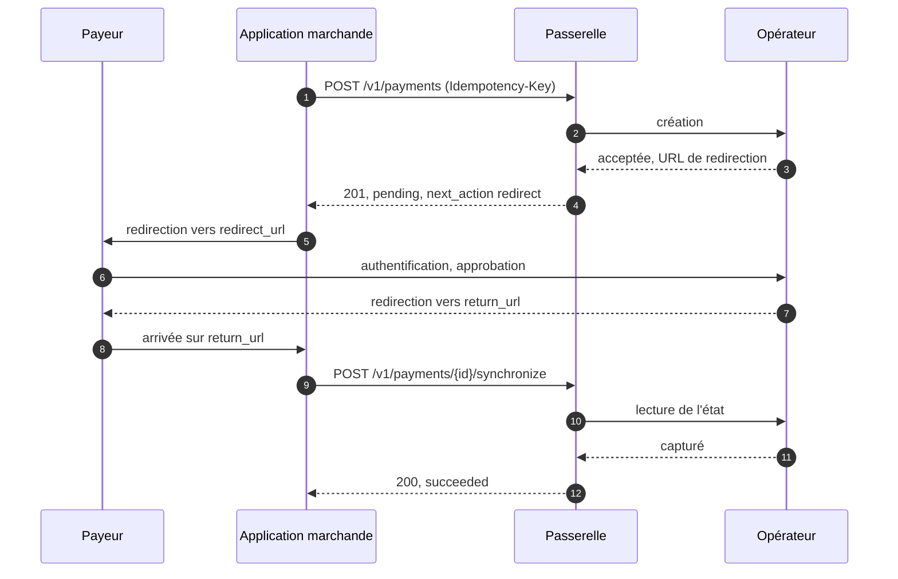

# API HTTP : paiements

Je justifie ces choix dans [ADR-0006](../text/0006-gateway-http-api-payments.md).

## 1. Conventions HTTP

Je fixe ces conventions pour tout point d'accès OpenFSP.

**1.1.** HTTPS uniquement. La passerelle NE DOIT PAS servir l'API en HTTP clair hors d'un mode
de développement explicite, qui DOIT être annoncé dans le journal de démarrage.

**1.2.** Tous les points d'accès sont sous `/v1`. La version majeure ne change qu'en cas de
rupture de compatibilité.

**1.3.** Les versions mineures ne figurent pas dans le chemin ; les ajouts se découvrent par la
[découverte de capacités](capacites.md).

**1.4.** Requêtes et réponses de succès en `application/json` ; erreurs en
`application/problem+json` (10.1.1).

**1.5.** Un corps présent avec un `Content-Type` non pris en charge DOIT être rejeté avec
`malformed-request`.

**1.6.** `POST` crée ou agit, `GET` lit. `PATCH` et `DELETE` ne sont pas utilisés ici. Une
méthode non implémentée sur un chemin connu DOIT recevoir `405` avec `Allow`.

**1.7.** Portée de l'idempotence : [idempotence 1](idempotence.md). Seule la synchronisation (5.3) en est exemptée ; la
passerelle NE DOIT PAS étendre l'exemption.

**1.8.** Toute réponse, succès ou erreur, porte l'en-tête `Request-Id` égal au `request_id`
(10.1.6).

**1.9.** Champs inconnus : rejet en requête, tolérance en réponse ([modèle de données 2.3, 2.4](modele-de-donnees.md)).

**1.10.** Les chemins sont canoniques sans barre oblique finale ; `/v1/payments/` DOIT être
traité comme `/v1/payments`.

**1.11.** Tout horodatage est un `Timestamp` ([modèle de données 7](modele-de-donnees.md)).

**1.12.** Une collection est un objet à membre OBLIGATOIRE `data`, tableau de ressources, jamais
un tableau nu : `{ "data": [] }`.

## 2. Capacité de base

**2.1.** Les trois opérations du 5 forment la capacité `payments`. Une passerelle conforme DOIT
les implémenter pour chaque opérateur qu'elle prend en charge ; sans `payments.lookup`, la
synchronisation suit le [capacités 5.3](capacites.md).

**2.2.** La passerelle NE DOIT PAS subordonner ces opérations à une interrogation préalable de
la découverte de capacités.

## 3. Ressource `Payment`

```json
{
  "id": "pay_01J9ZK3QF8XN2M7VYB4C6D8E0G",
  "reference": "INV-2026-00184",
  "status": "pending",
  "amount": { "amount": 125000, "currency": "HTG" },
  "provider": "moncash",
  "provider_reference": null,
  "provider_order_id": "q3v7m2kxbh4tapewdc5nzr2b3z",
  "payer": { "phone_number": "+50934567890" },
  "description": "Invoice 184",
  "next_action": {
    "type": "redirect",
    "redirect_url": "https://provider.example/checkout/abc123",
    "expires_at": "2026-08-17T15:02:07Z"
  },
  "created_at": "2026-08-17T14:32:07.412Z",
  "updated_at": "2026-08-17T14:32:07.412Z",
  "expires_at": "2026-08-17T15:02:07Z",
  "completed_at": null,
  "failure_reason": null,
  "failure_detail": null,
  "fee": null,
  "metadata": { "order_id": "184" }
}
```

**3.1.** Champs :

| Champ | Type | Présence | Notes |
|---|---|---|---|
| `id` | `ResourceId` | OBLIGATOIRE | Opaque. |
| `reference` | `Reference` | OBLIGATOIRE | Unique par passerelle. |
| `status` | chaîne | OBLIGATOIRE | [Cycle de vie 1](cycle-de-vie.md). |
| `amount` | `Money` | OBLIGATOIRE | |
| `provider` | chaîne | OBLIGATOIRE | Identifiant enregistré de l'opérateur (3.2). |
| `provider_reference` | `ProviderReference` | FACULTATIF | Absent tant que l'opérateur n'en fournit pas ([modèle de données 6.3.2](modele-de-donnees.md)). |
| `provider_order_id` | chaîne | OBLIGATOIRE | Identifiant de commande transmis à l'opérateur ([idempotence 7.2](idempotence.md)). |
| `payer` | objet | FACULTATIF | 3.3. |
| `description` | chaîne | FACULTATIF | 255 caractères au plus. |
| `next_action` | objet | conditionnel | 4.1. |
| `created_at` | `Timestamp` | OBLIGATOIRE | Immuable. |
| `updated_at` | `Timestamp` | OBLIGATOIRE | [Cycle de vie 4.2](cycle-de-vie.md). |
| `expires_at` | `Timestamp` | FACULTATIF | [Cycle de vie 5](cycle-de-vie.md). |
| `completed_at` | `Timestamp` | conditionnel | OBLIGATOIRE si terminal. |
| `failure_reason` | chaîne | conditionnel | OBLIGATOIRE si `failed`. |
| `failure_detail` | objet | FACULTATIF | Erreur brute de l'opérateur. |
| `fee` | `Fee` | FACULTATIF | Absent signifie non connu (3.5). |
| `metadata` | `Metadata` | FACULTATIF | |

**3.2.** `provider` correspond à `^[a-z0-9_]{1,32}$` et DOIT être l'identifiant du
[registre des opérateurs](https://github.com/openfspht/openfsp/blob/main/registries/providers.md),
ou un identifiant `mock_*` du [serveur simulé](conformite.md#9-serveur-simulé). Il est OBLIGATOIRE même si la passerelle ne sert qu'un opérateur.

**3.3.** `payer` porte un seul champ, `phone_number` (`PhoneNumber`).

**3.4.** `description` PEUT être transmise à l'opérateur et affichée au payeur. Le client NE
DOIT PAS y placer de données personnelles.

**3.5.** `fee` :

- une création contenant `fee` DOIT être rejetée ;
- `fee` PEUT n'apparaître qu'une fois le paiement terminal ; son arrivée change `updated_at`
  sans changer `status` ;
- un client NE DOIT PAS afficher son absence comme zéro ([modèle de données 8.2](modele-de-donnees.md)).

## 4. `next_action`

**4.1.** OBLIGATOIRE tant que le paiement est `pending`, absent une fois terminal.

**4.2.** Énumération fermée :

| `type` | Sens | Champs |
|---|---|---|
| `redirect` | Envoyer le payeur vers une page de l'opérateur. | `redirect_url`, `expires_at` |
| `payer_approval` | Le payeur approuve sur son appareil (USSD, notification). | aucun |
| `none` | Rien n'est requis du payeur. | aucun |

**4.3.** La passerelle DOIT rapporter le type exigé par l'opérateur. Si ce type ne
peut pas être déterminé, la création échoue avec une erreur ; `none` NE DOIT PAS servir de
valeur par défaut.

**4.4.** Un client DOIT traiter `redirect_url` comme opaque, NE DOIT PAS la réécrire, et NE
DOIT PAS l'intégrer dans un cadre qui en masque l'origine.

**4.5.** `next_action.expires_at` PEUT précéder l'`expires_at` du paiement. Son expiration ne
rend pas le paiement terminal.

**4.6.** Une capacité PEUT ajouter un type ; il n'est produit que pour un opérateur qui annonce
cette capacité. Un client qui reçoit un type inconnu NE DOIT PAS le traiter comme `none`.

## 5. Points d'accès

### 5.1. Créer un paiement

```
POST /v1/payments
```

```json
{
  "reference": "INV-2026-00184",
  "amount": { "amount": 125000, "currency": "HTG" },
  "provider": "moncash",
  "payer": { "phone_number": "+50934567890" },
  "description": "Invoice 184",
  "return_url": "https://merchant.example/checkout/184/return",
  "expires_at": "2026-08-17T15:02:07Z",
  "metadata": { "order_id": "184" }
}
```

| Champ | Présence | Notes |
|---|---|---|
| `reference` | OBLIGATOIRE | Doublon : `reference-conflict`. |
| `amount` | OBLIGATOIRE | Strictement positif, dans les bornes ([capacités 6](capacites.md)). |
| `provider` | OBLIGATOIRE | 5.1.1. |
| `payer` | conditionnel | Selon l'opérateur (5.1.2). |
| `description` | FACULTATIF | |
| `return_url` | conditionnel | OBLIGATOIRE si l'opérateur annonce `return_url_required` ([capacités 3.2.2](capacites.md)). |
| `expires_at` | FACULTATIF | Valeur demandée ; la valeur retenue est celle de la réponse (5.1.4). |
| `locale` | FACULTATIF | Langue de la page du payeur : `fr`, `ht` ou `en` (5.1.7). |
| `metadata` | FACULTATIF | |

**5.1.1.** La passerelle NE DOIT PAS choisir l'opérateur à la place du client.

**5.1.2.** La passerelle DOIT documenter, par adaptateur, si `payer` est exigé, et DOIT rejeter
avec `missing-field` une requête privée d'un champ exigé par l'opérateur.

**5.1.3.** `return_url` DOIT être une URL `https` absolue ; une URL `http` DOIT être rejetée.

**5.1.4.** La passerelle fixe l'`expires_at` de la ressource à ce que l'opérateur garantit, qui
PEUT différer de la demande ou être absent. Un client DOIT relire la valeur.

| Statut | Condition |
|---|---|
| `201` | Paiement créé ; `Location` porte son URL. |
| `400`, `422` | Requête invalide (10.9.1). |
| `409 reference-conflict` | Référence déjà utilisée (5.1.5). |
| `502`, `503`, `504` | Échec côté opérateur ; lire `effect`. |

**5.1.5.** Sur `reference-conflict`, le client DEVRAIT lire le paiement existant (5.2).

**5.1.6.** Sur `504 provider-timeout` ou `500 internal-error`, `effect` vaut `unknown`
(10.6.3).

**5.1.7.** La passerelle transmet `locale` à l'opérateur s'il figure dans les `locales` annoncées
([capacités 3.2.2](capacites.md)), et l'ignore sinon. Une autre valeur que `fr`, `ht` ou `en`
DOIT être rejetée avec `invalid-field`.

### 5.2. Lire un paiement

```
GET /v1/payments/{id}
GET /v1/payments?reference={reference}
```

**5.2.1.** Par `id` : le paiement, ou `404 not-found`.

**5.2.2.** Par `reference` : une collection d'au plus un élément. Une référence inconnue donne
`200` avec `data` vide.

**5.2.3.** Les bibliothèques clientes DEVRAIENT exposer la recherche par référence.

**5.2.4.** Une lecture renvoie l'état enregistré par la passerelle ; elle NE DOIT PAS appeler
l'opérateur.

### 5.3. Synchroniser un paiement

```
POST /v1/payments/{id}/synchronize
```

**5.3.1.** La passerelle relit l'état chez l'opérateur, applique la transition qui en découle
selon le [cycle de vie](cycle-de-vie.md), et renvoie le paiement.

**5.3.2.** La passerelle DOIT implémenter ce point d'accès et DEVRAIT aussi rapprocher en
arrière-plan ([cycle de vie 6.2](cycle-de-vie.md)).

**5.3.3.** Sur un paiement terminal, la passerelle NE DOIT PAS appeler l'opérateur et DOIT
renvoyer le paiement inchangé en `200`.

**5.3.3.1.** Ce contrôle précède tout autre, y compris celui de capacité
([capacités 5.3](capacites.md)).

**5.3.4.** Opérateur injoignable : `503 provider-unavailable` ou `504 provider-timeout` ; le
paiement reste `pending`.

**5.3.5.** La passerelle DEVRAIT limiter le débit de ce point d'accès par paiement
(`429 rate-limited` avec `Retry-After`).

**5.3.6.** Ce point d'accès est exempté d'`Idempotency-Key` ([idempotence 1.4](idempotence.md)).

## 6. Suivi des changements

**6.1.** Un client apprend un changement d'état par lecture (5.2), synchronisation (5.3) ou
[webhook](webhooks.md).

**6.2.** Un client DEVRAIT sonder à intervalles croissants et DEVRAIT s'arrêter dès que le paiement est
terminal.

**6.3.** Voir [webhooks 10](webhooks.md).

## 7. URL de retour

**7.1.** Un client NE DOIT PAS traiter le retour du payeur sur `return_url` comme preuve d'un
dénouement.

**7.2.** Les paramètres ajoutés par l'opérateur à `return_url` sont contrôlables par un
attaquant.

**7.3.** Au retour, un client DOIT lire le paiement auprès de la passerelle et afficher le
résultat de cette seule réponse.

**7.4.** Si l'opérateur ne prend pas d'URL de retour par paiement, la passerelle DOIT exposer un
point de retour par opérateur, que l'exploitant déclare chez celui-ci. Ce point :

- DOIT retrouver le paiement par l'identifiant de commande reçu ([idempotence 7.2](idempotence.md)) ;
- DEVRAIT déclencher une synchronisation (5.3) ;
- DOIT rediriger en `303` vers la `return_url` enregistrée du paiement et NE DOIT PAS rediriger
  vers une URL reçue en paramètre ;
- DOIT répondre `404` sans redirection si le paiement est inconnu, sans distinguer un
  identifiant mal formé d'un identifiant inconnu.

**7.5.** Le point de retour n'est pas authentifié ([authentification 1.1](authentification.md))
et DOIT être limité en débit.

## 8. Flux type

Informatif : je décris le déroulement type d'un paiement par redirection.



## 9. Sécurité

**9.1.** La recherche par référence porte sur les paiements de la passerelle, que tout principal
autorisé voit ([authentification 5.5](authentification.md)).

**9.2.** Une clé sans la portée requise reçoit `forbidden`
([authentification 6.4](authentification.md)).

**9.3.** La documentation client DEVRAIT préciser que `description` peut être transmise
à l'opérateur et affichée au payeur, contrairement à `metadata` (3.4).

## 10. Erreurs

### 10.1. Format

**10.1.1.** Toute réponse d'erreur DOIT être un problem detail (RFC 9457) de type de média
`application/problem+json`.

**10.1.2.** Exemple :

```json
{
  "type": "https://openfsp.org/problems/provider-timeout",
  "title": "The provider did not respond in time",
  "status": 504,
  "detail": "No response from the provider after 30s. The payment's outcome is unknown.",
  "instance": "/v1/payments",
  "retryable": true,
  "effect": "unknown",
  "request_id": "req_01J9ZK3QF8XN2M7VYB4C6D8E0G"
}
```

**10.1.3.** Membres :

| Membre | Type | Présence | Notes |
|---|---|---|---|
| `type` | URI | OBLIGATOIRE | Identifiant stable (10.3). |
| `title` | chaîne | OBLIGATOIRE | Lisible, non stable. |
| `status` | entier | OBLIGATOIRE | Statut HTTP. |
| `detail` | chaîne | FACULTATIF | Lisible, propre à l'occurrence, non stable. |
| `instance` | référence d'URI | FACULTATIF | Chemin de la requête. |
| `retryable` | booléen | OBLIGATOIRE | 10.5. |
| `effect` | chaîne | OBLIGATOIRE | `none` ou `unknown` (10.6). |
| `request_id` | chaîne | OBLIGATOIRE | Corrélation avec les journaux de la passerelle. |
| `errors` | tableau | FACULTATIF | Détail par champ (10.7). |
| `provider_detail` | objet | FACULTATIF | Relais de l'opérateur (10.8). |

**10.1.4.** Un client DOIT identifier une erreur par son seul `type`. `title` et `detail` PEUVENT
changer ou être localisés.

**10.1.5.** `status` DOIT être égal au statut HTTP de la réponse.

**10.1.6.** `request_id` DOIT être présent sur toute erreur, y compris `500`.

### 10.2. Requête échouée et paiement échoué

**10.2.1.** Une réponse d'erreur rapporte l'échec de la requête ; le dénouement du paiement est
porté par `status` (10.2.2).

**10.2.2.** Un paiement refusé est rapporté en `200`, avec `"status": "failed"` et un
`failure_reason` ([cycle de vie 7.2](cycle-de-vie.md)).

**10.2.3.** La passerelle NE DOIT PAS rapporter un paiement refusé par une réponse d'erreur, ni
utiliser un statut `4xx` ou `5xx` pour le dénouement d'un paiement.

**10.2.4.** Un client NE DOIT PAS traiter une réponse non `2xx` comme un paiement échoué. Son
effet est donné par `effect`.

### 10.3. URI de type

**10.3.1.** Forme : `https://openfsp.org/problems/<code>`, `<code>` venant du catalogue du 10.9.

**10.3.2.** Un client DOIT comparer ces URI comme des chaînes opaques et NE DOIT PAS les
déréférencer pour interpréter une réponse.

**10.3.3.** L'éditeur de la spécification DEVRAIT publier une documentation du type à chaque
URI de type ; cette règle ne lie pas les implémentations.

**10.3.4.** Les URI de type DOIVENT conserver l'autorité `openfsp.org` dans toutes les versions.

**10.3.5.** Une passerelle PEUT définir des types sous sa propre autorité et NE DOIT PAS en
définir sous l'autorité OpenFSP.

**10.3.6.** Face à un `type` inconnu, un client DOIT se fonder sur `status`, `retryable` et
`effect`. Un ajout au catalogue n'est pas une rupture de compatibilité.

### 10.4. Statuts

**10.4.1.** La passerelle DOIT utiliser le statut assigné par le catalogue.

**10.4.2.** Les statuts suivent la RFC 9110 : `400` requête illisible ou mal formée, `422`
contenu invalide, `409` conflit avec un état détenu par la passerelle.

**10.4.3.** `idempotency-key-reused` est en `422`, `idempotency-request-in-progress` en `409`,
comme dans le brouillon IETF `Idempotency-Key`.

**10.4.4.** Côté opérateur : `502` réponse invalide ou erreur de l'opérateur, `503` opérateur
injoignable, `504` pas de réponse à temps.

### 10.5. `retryable`

**10.5.1.** `retryable` indique si répéter la requête inchangée, avec la même `Idempotency-Key`,
peut réussir.

**10.5.2.** `retryable: true` indique qu'un renvoi avec la même `Idempotency-Key` ne produit pas
d'effet en double ; il n'en garantit pas le succès.

**10.5.3.** Un client NE DOIT PAS renvoyer une requête dont l'erreur porte `retryable: false`.

**10.5.4.** Un client qui renvoie DOIT réutiliser la clé d'origine et espacer ses renvois
([idempotence 8.1, 8.4](idempotence.md)).

**10.5.5.** Un client DOIT respecter `Retry-After`.

**10.5.6.** `retryable` DOIT correspondre à la valeur du catalogue.

### 10.6. `effect`

**10.6.1.** Valeurs :

| Valeur | Sens |
|---|---|
| `none` | L'opération n'a pas pris effet. |
| `unknown` | L'opération a pu prendre effet. |

**10.6.2.** La passerelle DOIT rapporter `none` seulement si elle peut l'établir, `unknown`
sinon.

**10.6.3.** Sur `unknown`, un client NE DOIT PAS conclure à l'échec. Il DOIT renvoyer avec la clé
d'origine ou lire la ressource par sa `reference`
([modèle de données 6.2.3](modele-de-donnees.md)).

**10.6.4.** `effect` et `retryable` sont indépendants.

**10.6.5.** La passerelle NE DOIT PAS enregistrer au titre de l'[idempotence](idempotence.md)
une erreur portant `effect: unknown` ; un renvoi est traité selon idempotence 3.

### 10.7. Erreurs par champ

**10.7.1.** Si l'erreur concerne des champs précis, `errors` DEVRAIT être présent :

| Membre | Type | Présence | Notes |
|---|---|---|---|
| `field` | chaîne | OBLIGATOIRE | JSON Pointer (RFC 6901) dans le corps de la requête. |
| `code` | chaîne | OBLIGATOIRE | Code stable. |
| `detail` | chaîne | FACULTATIF | Lisible, non stable. |

```json
{
  "type": "https://openfsp.org/problems/invalid-field",
  "title": "One or more fields are invalid",
  "status": 422,
  "retryable": false,
  "effect": "none",
  "request_id": "req_01J9ZK…",
  "errors": [
    { "field": "/amount/amount", "code": "not_positive" },
    { "field": "/payer/phone_number", "code": "malformed" }
  ]
}
```

**10.7.2.** La passerelle DEVRAIT rapporter tous les champs invalides dans une seule réponse.

**10.7.3.** `field` DOIT désigner la requête telle qu'envoyée par le client.

### 10.8. Relais de l'opérateur

**10.8.1.** Pour une erreur venant de l'opérateur, `provider_detail` DEVRAIT porter son code et
son message :

```json
"provider_detail": { "code": "E4021", "message": "Subscriber not registered" }
```

**10.8.2.** La passerelle NE DOIT PAS l'analyser ni en dériver `type`, `retryable` ou `effect`,
et DOIT le relayer sans altération.

**10.8.3.** Un client NE DOIT PAS s'appuyer sur `provider_detail` pour une décision
programmatique.

**10.8.4.** `provider_detail` NE DOIT contenir aucun identifiant secret, jeton ou matériel
d'authentification ; la passerelle DOIT caviarder un tel contenu.

### 10.9. Catalogue

Fermé ; l'étendre requiert une ADR.

#### 10.9.1. Requête

| Code | Statut | `retryable` | `effect` | Condition |
|---|---|---|---|---|
| `malformed-request` | 400 | false | `none` | Corps non JSON ou non objet. |
| `unknown-field` | 400 | false | `none` | Champ inconnu ([modèle de données 2.4](modele-de-donnees.md)). |
| `missing-field` | 400 | false | `none` | Champ obligatoire absent. |
| `method-not-allowed` | 405 | false | `none` | Méthode non implémentée sur un chemin connu (1.6). DOIT porter `Allow`. |
| `idempotency-key-required` | 400 | false | `none` | `Idempotency-Key` absente ([idempotence 1.3](idempotence.md)). |
| `invalid-field` | 422 | false | `none` | Contenu invalide. Porte `errors`. |
| `capability-not-supported` | 422 | false | `none` | Capacité non annoncée. |
| `amount-out-of-range` | 422 | false | `none` | Montant hors des bornes annoncées ([capacités 6.7](capacites.md)). |
| `idempotency-key-reused` | 422 | false | `none` | Même clé, corps différent ([idempotence 3.3](idempotence.md)). |

#### 10.9.2. Authentification

| Code | Statut | `retryable` | `effect` | Condition |
|---|---|---|---|---|
| `unauthenticated` | 401 | false | `none` | Identifiant absent, mal formé ou invalide. |
| `forbidden` | 403 | false | `none` | Authentifié, non autorisé. |

#### 10.9.3. Ressource

| Code | Statut | `retryable` | `effect` | Condition |
|---|---|---|---|---|
| `not-found` | 404 | false | `none` | Ressource inexistante. |

**10.9.3.1.** La passerelle DOIT vérifier la portée avant l'existence de la ressource : une clé
sans la portée requise reçoit `forbidden` que la ressource existe ou non
([authentification 6.4](authentification.md)), de sorte que la réponse ne révèle pas son
existence.

#### 10.9.4. Conflits

| Code | Statut | `retryable` | `effect` | Condition |
|---|---|---|---|---|
| `reference-conflict` | 409 | false | `none` | `reference` déjà utilisée ([modèle de données 6.2.2](modele-de-donnees.md)). |
| `idempotency-request-in-progress` | 409 | true | `unknown` | Requête de même clé en cours ([idempotence 3.4](idempotence.md)). |
| `state-conflict` | 409 | false | `none` | Opération interdite depuis l'état courant ([cycle de vie 2.1](cycle-de-vie.md)). |

**10.9.4.1.** Réservé.

**10.9.4.2.** `idempotency-request-in-progress` DEVRAIT porter `Retry-After`.

#### 10.9.5. Débit

| Code | Statut | `retryable` | `effect` | Condition |
|---|---|---|---|---|
| `rate-limited` | 429 | true | `none` | Trop de requêtes. DOIT porter `Retry-After`. |

#### 10.9.6. Passerelle et opérateur

| Code | Statut | `retryable` | `effect` | Condition |
|---|---|---|---|---|
| `internal-error` | 500 | true | `unknown` | Défaillance inattendue de la passerelle. |
| `provider-error` | 502 | true | `unknown` | Erreur ou réponse inexploitable de l'opérateur. |
| `provider-unavailable` | 503 | true | `none` | Opérateur injoignable. |
| `provider-timeout` | 504 | true | `unknown` | Pas de réponse de l'opérateur à temps. |

**10.9.6.1.** `provider-unavailable` NE DOIT être utilisé que si aucune requête n'a atteint
l'opérateur (connexion refusée, échec DNS). Si une requête a été envoyée sans dénouement
connu, `provider-timeout` s'applique.

**10.9.6.2.** `internal-error` DOIT porter `unknown`, sauf si la passerelle établit qu'aucun appel
à l'opérateur n'a eu lieu.

**10.9.6.3.** `internal-error` NE DOIT PAS inclure de diagnostic interne (trace, requête, nom
d'hôte).

### 10.10. Langue

**10.10.1.** `title` et `detail` DEVRAIENT être en anglais par défaut.

**10.10.2.** Une passerelle PEUT les localiser et DEVRAIT alors honorer `Accept-Language`.

**10.10.3.** La localisation NE DOIT PAS modifier `type`, `retryable`, `effect` ni aucun `code`.

### 10.11. Sécurité

**10.11.1.** `title`, `detail` et `errors[].detail` NE DOIVENT PAS contenir de numéro de
téléphone, d'identifiant de payeur ni de montant.

**10.11.2.** `unauthenticated` NE DOIT PAS distinguer les causes d'échec énumérées à
l'[authentification 4.7](authentification.md).

**10.11.3.** Les bibliothèques clientes DEVRAIENT documenter l'échappement obligatoire de
`provider_detail` à l'affichage.
