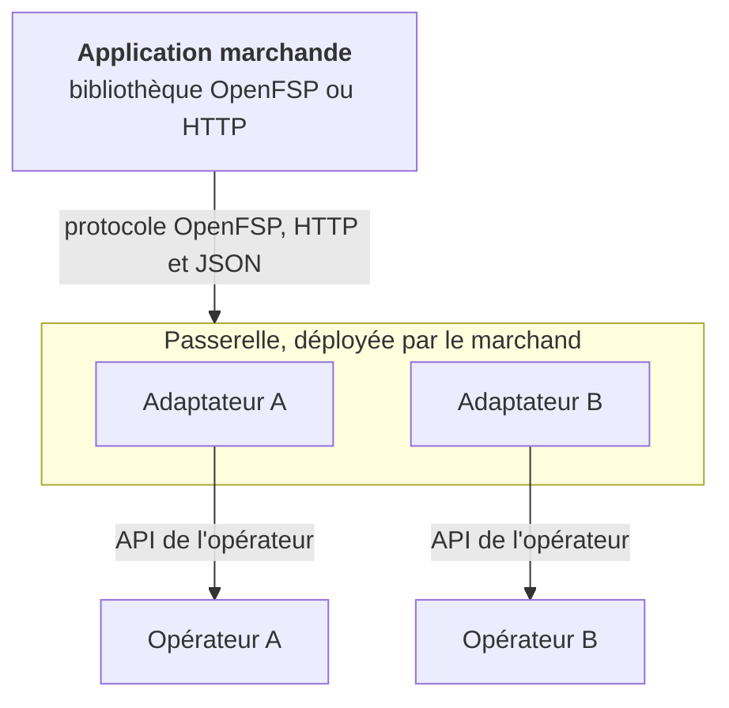

# Architecture et périmètre

Informatif. Je justifie ce cadrage dans l'[ADR-0001](../text/0001-architecture-and-scope.md).

## Hors périmètre

J'exclus du périmètre les points suivants ; en lever un exige une ADR.

- OpenFSP ne détient, ne déplace ni ne conserve de fonds. La passerelle instruit les opérateurs
  et n'est jamais partie à une transaction.
- OpenFSP n'exploite aucun service hébergé. Une offre hébergée fondée sur OpenFSP relève de son
  exploitant et de ses propres obligations réglementaires (voir
  [Considérations réglementaires](#considérations-réglementaires)).
- OpenFSP n'est pas un établissement de paiement agréé et ne remplace aucun agrément ni aucun
  contrat avec un opérateur.
- OpenFSP n'est ni un commutateur, ni une chambre de compensation, ni un système de règlement.
- OpenFSP ne certifie pas les opérateurs.
- OpenFSP ne spécifie aucune interface utilisateur.

## Composants

| Composant | Rôle | Technologie |
|---|---|---|
| Spécification | Règles normatives : modèle de données, cycle de vie, capacités, erreurs, idempotence, webhooks. | Markdown ; description OpenAPI à publier avec l'implémentation |
| Passerelle | Serveur auto-hébergé : protocole OpenFSP d'un côté, API des opérateurs de l'autre. | Kotlin, Spring Boot |
| Serveur simulé | Imite les opérateurs, défaillances comprises. | Kotlin, Spring Boot |
| Bibliothèques clientes | Clients légers du protocole. | TypeScript, PHP, Python |
| Suite de conformité | Tests exécutables contre une implémentation, rapport reproductible ([conformité](conformite.md)). | Non arrêtée |

En développement et en intégration continue, le [serveur simulé](conformite.md#9-serveur-simulé) remplace
les opérateurs.

## Déploiement et confiance

- L'exploitant, le marchand ou son mandataire, déploie la passerelle et détient ses secrets
  d'opérateur ; le projet ne les détient jamais.
- La relation entre le marchand et son opérateur est inchangée.
- Aucun service multi-locataire.
- La passerelle est distribuée en un binaire unique accompagné de sa base de données, avec des
  réglages par défaut sûrs et un guide de durcissement.

## Principes de conception

| Principe | Règle détaillée |
|---|---|
| Une opération absente est déclarée absente, jamais émulée ; la capacité de base se limite à créer, lire et synchroniser un paiement. | [Capacités](capacites.md) |
| Un montant est un entier en centimes de gourde, avec devise explicite. | [Modèle de données 3](modele-de-donnees.md) |
| Toute création est idempotente ; seule la synchronisation en est exemptée. | [Idempotence](idempotence.md) |
| La référence du marchand est la clé de corrélation. | [Modèle de données 6.2](modele-de-donnees.md) |
| Les états forment une machine explicite ; un état terminal n'est jamais quitté. | [Cycle de vie](cycle-de-vie.md) |
| Les erreurs sont neutres, l'erreur de l'opérateur est conservée. | [API 10](api-paiements.md) |
| La passerelle ne choisit pas l'opérateur ; une erreur porte `effect`. | [API 5.1.1, 10.6](api-paiements.md) |
| Protocole standard : HTTP, JSON, codes de statut et en-têtes standard. | [API 1](api-paiements.md) |

## Normes

| Sujet | Norme |
|---|---|
| Mots-clés d'exigence | RFC 2119, RFC 8174 (équivalents français, [README](README.md)) |
| Erreurs | RFC 9457 |
| Horodatages | RFC 3339, UTC |
| Devise | ISO 4217 (HTG) |
| Téléphone | UIT-T E.164 |
| Identifiants | RFC 9562, UUID version 7 |
| Signature des webhooks | RFC 9421 |
| Idempotence | Brouillon IETF `Idempotency-Key` |
| Description d'API | OpenAPI 3.1, à publier avec l'implémentation |
| Authentification | Schéma `Bearer`, RFC 9110 ([authentification 3](authentification.md)) ; OAuth 2.0 possible en amont |
| Découverte | RFC 8615 |
| Cadre réglementaire | Loi de 2012, circulaires BRH 121, 126, 131 ([références](../text/references.md)) |

Travaux voisins que je n'ai pas repris :

| Travail | Raison |
|---|---|
| GSMA Mobile Money API | Surface trop large ; référence de nommage. |
| Mojaloop, processeur national PRONAP | Couche du commutateur, complémentaire : seul un commutateur permet à un payeur chez A de payer un marchand qui n'accepte que B. |

Le marchand détient un compte chez chaque opérateur accepté : aucune valeur ne circule entre
opérateurs, aucune compensation n'est requise.

## Conformité

| Cible | Vérification |
|---|---|
| Client | Suite jouant la passerelle. |
| Passerelle | Suite jouant le client, serveur simulé jouant les opérateurs. |
| Opérateur natif | L'opérateur expose l'API OpenFSP ; aucun adaptateur n'est requis pour lui. |

Niveaux : Core et profils par capacité. Règles :
[conformité](conformite.md).

## Correspondance réglementaire

Je rattache à chaque exigence le champ OpenFSP qui la porte ; cette correspondance ne vaut pas
attestation qu'un déploiement satisfait les circulaires.

**BRH-121 8, reçu.** Le reçu incombe au FSP ; OpenFSP en porte les données.

| Mention exigée | OpenFSP |
|---|---|
| Référence de la transaction | `reference`, `provider_reference` |
| Nature du service | absente : `description` ou `metadata` |
| « Nom du fournisseur » (libellé BRH-121) | `provider` |
| Parties | `payer` et marchand |
| Date | `completed_at` |
| Montant | `amount` |
| Frais | `fee` |
| Nom de l'agent, le cas échéant | sans objet : pas d'agent dans un paiement marchand |

**BRH-121 13.1, identification et traçabilité.** Payeur en E.164, marchand identifié par sa
passerelle ([authentification 5](authentification.md)) ; `reference`, `id`, `request_id` et audit
([authentification 10](authentification.md)).

**BRH-121 13.4, registre.** La ressource paiement est le registre ; les
[webhooks](webhooks.md) en sont une vue dérivée.

**BRH-121 13.5, temps réel et irrévocabilité.** La terminalité de `succeeded`
([cycle de vie 3.1](cycle-de-vie.md)) s'y aligne ; un remboursement est un paiement distinct.

**BRH-121 15, données.** Transmission : [API 1.1](api-paiements.md),
[webhooks 7.2](webhooks.md). Conservation et identifiants :
[authentification 4, 9](authentification.md).

| Exigence | OpenFSP |
|---|---|
| BRH-126 2 : disponibilité, intégrité, confidentialité, traçabilité | Disponibilité : [API 5.3.4](api-paiements.md) ; intégrité : [webhooks 5](webhooks.md), [cycle de vie 3](cycle-de-vie.md) ; confidentialité : [authentification 4, 9](authentification.md) ; traçabilité : [authentification 10](authentification.md). |
| BRH-126 3 p) : documentation tenue à jour | ADR et spécification versionnées. |
| BRH-126 3 n) : sécurité avant production | Sections « Sécurité » de chaque document normatif, listés au [README](README.md#documents). |
| BRH-126 3 t) : audit triennal | [Conformité](conformite.md), [authentification 10](authentification.md). |
| BRH-131 6.1 s) : signaler et compenser les pertes | `effect`, [API 10.9](api-paiements.md), `failure_reason`. |
| BRH-131 6.1 p) : pas de surcharge marchande | `fee.bearer` non fixable par le client ([modèle de données 8.3](modele-de-donnees.md)). |
| BRH-131 6.10.2 c) : minimisation | Numéro du payeur hors des journaux ([modèle de données 10.1](modele-de-donnees.md)). |

## Langue

J'ai rédigé la spécification en français, qui fait foi. Les noms de champs et les valeurs
transmises restent en anglais. Mots-clés : [README](README.md#mots-clés). Une édition anglaise
est une traduction.

## Versions

Je retiens le versionnement sémantique, avec les garanties de
[GOVERNANCE 5](https://github.com/openfspht/openfsp/blob/main/GOVERNANCE.md#5-garanties-de-stabilité).
Version majeure dans le chemin (`/v1`) ; ajouts découverts par les capacités. Avant `1.0.0`, une
version mineure peut rompre la compatibilité.

## Sécurité

- Transport TLS partout ([API 1.1](api-paiements.md), [webhooks 7.2](webhooks.md)).
- Secrets d'opérateur hors des fichiers versionnés, jamais journalisés
  ([authentification 9](authentification.md)).
- Un rappel ne fonde une transition que dans les cas (a) et (c) du
  [cycle de vie 6.5](cycle-de-vie.md).
- Toute transition est horodatée (`updated_at`, `completed_at`) ; une attestation est attribuée
  à une personne ([cycle de vie 6.8](cycle-de-vie.md)).
- Une passerelle compromise n'expose qu'un seul marchand.
- L'implémentation de référence est distribuée en artefact signé, reproductible, accompagné
  d'une nomenclature logicielle (SBOM).

## Considérations réglementaires

| Texte | Portée pour OpenFSP |
|---|---|
| Loi du 14 mai 2012, art. 2 | Six catégories d'institution financière ; un éditeur de spécification et de logiciel auto-hébergé n'en fait pas partie. |
| Loi de 2012, art. 3 et 7 | L'activité est définie par la réception de fonds du public avec obligation de restitution ; OpenFSP ne reçoit aucun fonds. |
| Loi de 2012, art. 6 | La BRH peut étendre la loi aux activités assimilables sans loi nouvelle : position valable en l'état du droit, non acquise. |
| BRH-121 2 | Trois catégories de sociétés visées ; ni l'éditeur ni le marchand qui déploie n'en relèvent. |
| BRH-121 5 | Interopérabilité du FSP avec les autres acteurs, audit externe triennal, sans étalon : la suite en fournit un pour la part applicative, sans démontrer l'interopérabilité entre FSP. |
| BRH-121 8, 13.1, 13.4, 13.5, 15 | Reçu, traçabilité, registre, irrévocabilité, données : voir la [correspondance réglementaire](#correspondance-réglementaire). |
| BRH-126 2, 3 n), 3 p), 3 t) | Propriétés de sécurité, exigences avant production, documentation tenue à jour, audit triennal. |
| BRH-131 6.1 s), 6.9 c) | Signaler et compenser les pertes dues au système ; responsabilités des parties : `effect` et le catalogue d'erreurs. |

Un déploiement hébergé par un tiers introduit une partie absente du modèle auto-hébergé ; BRH-121
définit un opérateur technique sans procédure d'autorisation. Je ne tranche pas ce point dans OpenFSP.

OpenFSP ne définit pas de reporting réglementaire ; les champs de la ressource `Payment` et des
relevés ([cycle de vie 10](cycle-de-vie.md)) en sont la source.

## Adaptateurs d'opérateur

Informatif. Je rassemble ici les obligations des autres spécifications applicables à un
adaptateur, et les profils des opérateurs visés.

### 1. Rôle

**1.1.** Un adaptateur traduit une opération OpenFSP vers l'API d'un opérateur et retraduit la
réponse. Il ne détient ni l'enregistrement de paiement, ni le magasin d'idempotence, ni les
transitions d'état, ni l'audit.

**1.2.** Un adaptateur rapporte la réponse de l'opérateur, ou l'absence de réponse exploitable.

**1.3.** L'adaptateur est le seul composant qui détient un secret d'opérateur
([authentification 9](authentification.md)).

### 2. Opérations

| Opération | Règle | Obligatoire |
|---|---|---|
| Créer un paiement | [API 5.1](api-paiements.md) | oui |
| Lire un paiement chez l'opérateur | [API 5.3](api-paiements.md), `payments.lookup` | non |
| Ingérer un rappel | [cycle de vie 6.3, 6.6](cycle-de-vie.md) | non |
| Lire un relevé | [cycle de vie 6.7](cycle-de-vie.md), `payments.statement` | non |
| Convertir un export de portail | [cycle de vie 10.5](cycle-de-vie.md) | non |

**2.1.** Lire un paiement dans le magasin de la passerelle n'est pas une opération d'adaptateur.

**2.2.** Une opération que l'opérateur ne sait pas faire n'est ni implémentée ni déclarée ; pas
d'implémentation partielle qui renvoie une erreur.

### 3. Refus

**3.1.** Aucune capacité inventée : l'adaptateur déclare ce que fait l'opérateur, jamais ce que
la passerelle pourrait émuler ([capacités 1.3, 5.3](capacites.md)).

**3.2.** Aucune terminalité inventée : un statut inconnu ne correspond à rien et le paiement reste
`pending` ([cycle de vie 1.1](cycle-de-vie.md)) ; un motif incertain donne `unspecified`
([cycle de vie 7.3](cycle-de-vie.md)).

**3.3.** Aucun renvoi invérifiable après un dénouement indéterminé :
[idempotence 7.1 à 7.3](idempotence.md).

### 4. Déclaration

**4.1.** L'adaptateur déclare les capacités du [registre](capacites.md) qu'il prend en charge.

**4.2.** La déclaration de l'adaptateur est fixe par opérateur ; la passerelle en retire une
capacité suspendue ([capacités 4.5](capacites.md)).

**4.3.** Elle inclut le profil de paiement : types de `next_action`, `payer` exigé, `return_url`
exigée, expiration garantie ([capacités 3.2.2](capacites.md)).

### 5. Correspondances

**5.1.** La correspondance des statuts de l'opérateur est totale, ou documentée comme partielle ;
chaque statut observé correspond à un état OpenFSP ou à rien.

**5.2.** Elle va de l'opérateur vers OpenFSP, jamais l'inverse.

**5.3.** Un statut ambigu de l'opérateur (« pas encore agi » ou « inconnu ») correspond à
`pending`.

**5.4.** `failure_detail` porte le code et le message de l'opérateur, caviardés
([authentification 9.5](authentification.md)).

**5.5.** Choix entre `provider-unavailable` et `provider-timeout` :
[API 10.9.6.1](api-paiements.md).

### 6. Rappels

**6.1.** Rappel signé : vérifier. Une signature invalide ne fonde rien ; le rappel peut au plus
déclencher une consultation ([cycle de vie 6.3](cycle-de-vie.md)).

**6.2.** Rappel non signé hors URL propre au paiement : signal de consultation d'une source
faisant foi, contenu ignoré ([cycle de vie 6.3, 6.5](cycle-de-vie.md)).

**6.3.** Sans consultation, l'adaptateur déclare les sources restantes (URL propre au paiement,
relevé) ; sans aucune, chaque paiement attend une attestation ([cycle de vie 6.5](cycle-de-vie.md)).

**6.4.** Un rappel rejoué ne peut pas modifier un état terminal ([cycle de vie 3.1](cycle-de-vie.md)).
Une signature sans horodatage ni nonce, comme celle de NatCash, n'offre pas d'autre protection.

### 7. Document publié par adaptateur

| Élément | Usage |
|---|---|
| Capacités et profil de paiement | Données requises pour implémenter un client contre cet opérateur. |
| Correspondance des statuts, y compris sans correspondance | Comportement face à un statut imprévu. |
| Correspondance de `failure_reason` | Réactions automatiques du marchand. |
| Stratégie d'idempotence : [idempotence 7.2 ou 7.3](idempotence.md) | Exigé ([idempotence 7.4](idempotence.md)). |
| Rappels : signés, non signés, absents | Délai de connaissance des changements d'état. |
| Pertes connues | Champs ou distinctions que l'opérateur ne fournit pas. |
| Secrets d'opérateur requis et mode de fourniture | [Authentification 9.1](authentification.md). |
| Identifiant d'opérateur | [Registre](https://github.com/openfspht/openfsp/blob/main/registries/providers.md). |

### 8. Profils observés

J'ai établi ces profils d'après la documentation des opérateurs (MonCash REST API, NatCash
Merchant Online Integration 2.0) ; je liste au 8.5 les points non confirmés.

#### 8.1. Correspondance

| | MonCash | NatCash |
|---|---|---|
| Authentification | OAuth 2 `client_credentials`, jeton de 59 s | Identifiant, mot de passe et HMAC-SHA256 à chaque requête |
| Création | `amount`, `orderId` | `amount`, `orderNumber`, `callbackUrl`, `msisdn`, `language` |
| `next_action` | `redirect` | `redirect` |
| Expiration | Date absolue sans fuseau, échéance du jeton de paiement | Durée relative (`expiredAt`, unité non documentée) |
| URL de retour | Fixe, déclarée au portail marchand (non décrite dans la documentation d'API) : relais [API 7.4](api-paiements.md), par `orderId` ou, à défaut, `RetrieveTransactionPayment` sur le `transactionId` reçu | Non documentée : `return_url_required` à `false` ; page en WebView, dont l'origine reste visible ([API 4.4](api-paiements.md)) |
| Rappel | Non documenté | Par paiement, signé sur `orderNumber` et `code` |
| Consultation | `RetrieveOrderPayment` | `checkTransaction` |
| Relevé par API | Non | Non |
| Frais rapportés | Non | Non |
| Langue | Non | `fr`, `ht`, `en` |
| Annulation après succès | Non | Dans les 30 minutes (futur `payments.refund`) |
| Transferts | `Transfert`, statut et solde prépayé (futur `transfers`) | Non |

#### 8.2. Capacités annonçables

| | MonCash | NatCash |
|---|---|---|
| `payments` | oui | oui |
| `payments.lookup` | oui | oui |
| `webhooks.verify` | non | oui ([cycle de vie 6.3.1](cycle-de-vie.md)) |
| `webhooks.per_payment_url` | non | oui |
| `payments.statement` | non : relevé par import ([cycle de vie 10.5](cycle-de-vie.md)) | non : relevé par import |
| `payments.fee` | non | non |

Stratégie d'idempotence : recherche par identifiant de commande
([idempotence 7.2](idempotence.md)) pour les deux.

#### 8.3. Statuts

| Opérateur | Valeur | OpenFSP |
|---|---|---|
| MonCash | `message: "successful"` | `succeeded` |
| MonCash | Consultation sans paiement (format non documenté) | aucune tant que le format n'est pas observé en bac à sable ; `expired` par relevé importé attesté complet ([cycle de vie 5.3](cycle-de-vie.md) (d)) |
| NatCash | `1` | `succeeded` |
| NatCash | `-1` | `failed`, `unspecified` |
| NatCash | `-3` | aucune : `pending`, nouvelle consultation |
| NatCash | `ERR_TRANSACTION_EXPIRED` | aucune tant qu'on ignore s'il vise le jeton ou le paiement |
| NatCash | `ERR_TRANSACTION_NOT_FOUND` | aucune ; un paiement abandonné devient `expired` par relevé importé attesté complet ([cycle de vie 5.3](cycle-de-vie.md) (d)) |
| NatCash | `ERR_DUPLICATE_REQUEST_ID` | aucune : doublon de requête, pas un dénouement ([idempotence 7.2.1](idempotence.md)) |

#### 8.4. Pertes connues

- Aucun motif d'échec : `failure_reason` vaut `unspecified`. MonCash ne documente aucun échec :
  `failed` y est inatteignable par consultation.
- Sens de `cost` chez MonCash (montant ou frais) non documenté : il n'alimente ni `fee` ni le
  contrôle de montant du [cycle de vie 6.3.2](cycle-de-vie.md) avant observation.
- Aucuns frais : `fee` reste absent.
- Montants en décimal ou en chaîne, numéros sans `+`, dates MonCash sans fuseau : conversions du
  [modèle de données 3.9, 5.5, 7.5](modele-de-donnees.md).
- Refus des centimes non confirmé : `amount_step` reste absent tant que l'exploitant ne l'a pas
  constaté ([capacités 6.3](capacites.md)).

#### 8.5. À vérifier en bac à sable

1. Alphabet et longueur de l'`orderId` MonCash ([idempotence 7.2](idempotence.md)).
2. Réponse de `RetrieveOrderPayment` pour un paiement inexistant ou inachevé.
3. Réponses d'échec de MonCash.
4. Sens de `cost` chez MonCash.
5. Refus des centimes par l'un ou l'autre opérateur.
6. Rappel MonCash et paramètres transmis à l'URL de retour (`orderId` ou `transactionId`).
7. Unité d'`expiredAt` chez NatCash.
8. Portée d'`ERR_TRANSACTION_EXPIRED` : jeton ou paiement.
9. Format des exports de portail, pour l'import des relevés.

### 9. Tests

**9.1.** Sans accès à l'opérateur, la correspondance est testée sur des données et les refus sur
des réponses enregistrées.

**9.2.** La fidélité des réponses enregistrées à l'opérateur réel n'est pas testable ainsi.
