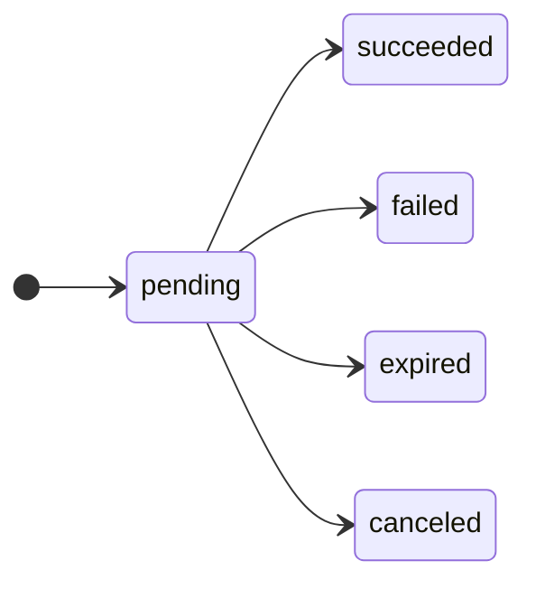

# Cycle de vie du paiement

Je justifie ces choix dans [ADR-0003](../text/0003-payment-lifecycle.md).

## 1. États

| État | Terminal | Signification |
|---|---|---|
| `pending` | non | Non encore connu comme terminal. |
| `succeeded` | oui | L'opérateur a confirmé la capture des fonds. |
| `failed` | oui | L'opérateur a rapporté que le paiement n'aboutira pas. |
| `expired` | oui | La fenêtre de paiement s'est fermée sans achèvement (5). |
| `canceled` | oui | Annulation rapportée par une source faisant foi. |

**1.1.** `pending` est le seul état non terminal. Il couvre indistinctement payeur inactif,
règlement en cours chez l'opérateur et absence de réponse.

**1.2.** Un client qui reçoit une valeur de `status` inconnue DOIT la traiter comme une erreur
de traitement et NE DOIT PAS en déduire un état, terminal ou non. Un nouvel état n'est
introduit qu'au titre du 8.

## 2. Transitions



**2.1.** Seules ces transitions sont permises :

| De | Vers | Cause |
|---|---|---|
| `pending` | `succeeded` | Confirmation de capture par une source faisant foi (6.5). |
| `pending` | `failed` | Refus ou erreur rapporté par une source faisant foi. |
| `pending` | `expired` | Conditions du 5.3. |
| `pending` | `canceled` | Annulation rapportée par une source faisant foi. |

**2.2.** La passerelle DOIT rejeter et NE DOIT PAS enregistrer toute autre transition. Un
statut d'opérateur impliquant une transition interdite est un conflit (6.4).

## 3. Terminalité

**3.1.** Un paiement terminal NE DOIT transiter vers aucun autre état, y compris sur un rapport
ultérieur contradictoire de l'opérateur.

**3.2.** La passerelle NE DOIT PAS entrer dans un état terminal par inférence ou par
écoulement du temps. Seule une source du 6.5 fonde une transition terminale ;
pour `expired`, le 5 s'applique en plus.

**3.3.** Une passerelle qui ne peut pas établir l'état auprès de l'opérateur DOIT laisser le
paiement `pending`.

**3.4.** Un paiement PEUT rester `pending` indéfiniment.

## 4. Champs

| Champ | Type | Présence | Notes |
|---|---|---|---|
| `status` | chaîne | OBLIGATOIRE | Une valeur du 1. |
| `created_at` | `Timestamp` | OBLIGATOIRE | Création par la passerelle. Immuable. |
| `updated_at` | `Timestamp` | OBLIGATOIRE | Dernier changement d'état ou de champ. |
| `expires_at` | `Timestamp` | FACULTATIF | Fermeture de la fenêtre de paiement (5). |
| `completed_at` | `Timestamp` | conditionnel | OBLIGATOIRE une fois terminal, absent avant. |
| `failure_reason` | chaîne | conditionnel | OBLIGATOIRE si `status` vaut `failed` (7). |
| `failure_detail` | objet | FACULTATIF | Erreur brute de l'opérateur (7.4). |

**4.1.** `completed_at` est l'instant où la passerelle a enregistré l'état terminal. Un
horodatage fourni par l'opérateur NE DOIT PAS remplacer `completed_at` ; sur un échec, il PEUT
figurer dans `failure_detail`.

**4.2.** `updated_at` DOIT changer à chaque transition et PEUT changer sans transition. Un
client NE DOIT PAS déduire une transition de `updated_at` seul.

**4.3.** Une fois l'état terminal atteint, `status`, `completed_at` et `failure_reason` sont
immuables. Les autres champs PEUVENT encore être complétés.

## 5. Expiration

**5.1.** `expires_at` est l'instant après lequel le payeur ne peut plus achever le paiement.

**5.2.** L'écoulement de `expires_at` ne fait pas, à lui seul, passer le paiement à `expired`.

**5.3.** La passerelle NE DOIT PAS enregistrer `expired` sans l'une de ces conditions :

- **(a)** l'opérateur a rapporté le paiement comme expiré ou définitivement inachevé,
  par une source du 6.5 (a) à (c) ;
- **(b)** `expires_at` est écoulé et une consultation postérieure chez l'opérateur indique
  que le paiement n'est pas achevé ;
- **(c)** l'opérateur garantit contractuellement qu'un paiement non achevé à `expires_at` ne
  s'achèvera jamais, et la passerelle documente ce comportement (seule exception au 3.2) ;
- **(d)** `expires_at` est écoulé et un relevé (6.7) couvrant une période qui s'achève après
  `expires_at` ne mentionne pas le paiement comme achevé (relevé importé : 10.5.2) ;
- **(e)** l'exploitant l'atteste (6.8).

**5.4.** Si aucune de ces conditions n'est remplie, le paiement reste `pending`.

## 6. Rapprochement

**6.1.** La passerelle DOIT disposer, pour tout paiement non terminal, d'au moins une source du
6.5, et DOIT annoncer par la [découverte de capacités](capacites.md) les sources dont elle
dispose pour chaque opérateur.

**6.2.** La passerelle DEVRAIT relire périodiquement les paiements non terminaux sans
sollicitation.

**6.3.** Un rappel d'opérateur ne fonde une transition que s'il relève du 6.5 (a) ou (c). Une signature
présente DOIT être vérifiée. Dans les autres cas, la passerelle NE DOIT PAS transiter sur le
contenu du rappel ; elle PEUT le traiter comme un signal pour consulter une autre source.

**6.3.1.** Un rappel signé ne relève du 6.5 (a) que si la signature couvre au moins
l'identifiant du paiement et son dénouement. Sinon, c'est un signal : la passerelle DEVRAIT
consulter aussitôt une autre source.

**6.3.2.** Si une source faisant foi rapporte un montant différent de celui du paiement, la
passerelle NE DOIT PAS enregistrer `succeeded`. Elle DOIT enregistrer et signaler l'écart comme
un conflit du 6.4, et le paiement reste `pending`.

**6.4. Conflits.** Si l'opérateur rapporte un état contredisant un état terminal enregistré,
ou un montant différent de celui du paiement (6.3.2), la passerelle NE DOIT PAS modifier le
paiement. Elle DOIT enregistrer le conflit de façon durable et le signaler à l'exploitant, et
NE DOIT PAS le résoudre automatiquement.

**6.5. Sources faisant foi.** La passerelle DEVRAIT utiliser la première disponible dans
cet ordre :

| Source | Capacité annoncée |
|---|---|
| **(a)** rappel dont la signature de l'opérateur est vérifiée | `webhooks.verify` |
| **(b)** consultation de l'état chez l'opérateur | `payments.lookup` |
| **(c)** rappel reçu sur une URL propre au paiement (6.6) | `webhooks.per_payment_url` |
| **(d)** relevé de l'opérateur obtenu par un canal authentifié (6.7) | `payments.statement` |
| **(e)** attestation de l'exploitant (6.8) | aucune, toujours disponible |

Une passerelle qui ne dispose pour un opérateur que de la source (e) PEUT annoncer `payments`
pour cet opérateur.

**6.6. URL propre au paiement.** Pour la source (c), la passerelle DOIT générer pour chaque
paiement un jeton d'au moins 128 bits issu d'un générateur cryptographique, DOIT l'inclure
dans le chemin de l'URL de rappel transmise à la création, et DOIT le comparer en temps
constant à la réception. Un rappel dont le jeton ne correspond à aucun paiement non terminal
DOIT être rejeté sans effet. Le jeton NE DOIT PAS être journalisé. Une URL commune à plusieurs
paiements NE DOIT PAS être traitée comme source (c).

**6.7. Relevé.** Pour la source (d), un paiement mentionné comme achevé est `succeeded` ;
mentionné comme refusé ou annulé, il prend l'état terminal correspondant. L'absence d'un
paiement ne fonde `expired` qu'au titre du 5.3 (d). Relevé importé : 10.5. Format et
rapprochement : 10.

**6.8. Attestation.** Pour la source (e), la passerelle DOIT enregistrer de façon durable
l'identité de la personne, l'horodatage, l'état attesté et la référence de la preuve. Ce moyen
DOIT relever de l'administration de la passerelle et NE DOIT PAS être exposé par
l'[API](api-paiements.md). Une attestation est soumise au 3.1 ; un rapport contradictoire
ultérieur relève du 6.4.

## 7. Échecs

**7.1.** Une réponse `200` portant un paiement `failed` rapporte une requête réussie
([API 10.2](api-paiements.md)). Les erreurs
d'API relèvent des [erreurs](api-paiements.md#10-erreurs), pas du cycle de vie.

**7.2.** Si `status` vaut `failed`, `failure_reason` DOIT prendre l'une de ces valeurs :

| Valeur | Signification |
|---|---|
| `declined` | Refus de l'opérateur sans motif plus précis. |
| `insufficient_funds` | Solde du payeur insuffisant. |
| `payer_canceled` | Le payeur a abandonné ou refusé. |
| `payer_unreachable` | Compte ou numéro du payeur injoignable. |
| `limit_exceeded` | Plafond de l'opérateur ou réglementaire dépassé, non annoncé ([capacités 6.9](capacites.md)). |
| `rejected_by_provider` | Refus propre à l'opérateur (risque, conformité). |
| `provider_error` | Défaillance rapportée par l'opérateur. |
| `unspecified` | Échec sans motif exploitable. |

**7.3.** `unspecified` DOIT être utilisé lorsque l'opérateur ne donne pas de motif ou que la
correspondance n'est pas certaine. La passerelle NE DOIT PAS deviner un motif plus précis.

**7.4.** `failure_detail` DOIT porter au minimum le code et le message d'erreur de
l'opérateur, inaltérés.

**7.5.** L'énumération est fermée ; l'étendre requiert une ADR. Un client DOIT traiter une
valeur inconnue comme `unspecified`.

## 8. Extension par capacité

**8.1.** Une capacité PEUT introduire des états supplémentaires.

**8.2.** Un tel état DOIT être défini par la spécification de la capacité, avec ses
transitions vers et depuis la machine de base et son caractère terminal ou non.

**8.3.** La passerelle NE DOIT PAS rapporter un état propre à une capacité qu'elle n'annonce
pas.

**8.4.** Une capacité NE DOIT PAS modifier le sens d'un état de base, ajouter une transition
sortant d'un état terminal, ni affaiblir le 3.

**8.5.** Un remboursement est une ressource distincte. Un paiement remboursé reste
`succeeded`.

## 9. Sécurité

**9.1.** Un client ou une passerelle qui affiche `failure_detail` DOIT en traiter le contenu
comme non fiable.

**9.2.** La passerelle DEVRAIT limiter le débit de création de paiements, contre
l'énumération de comptes par `payer_unreachable`.

**9.3.** La documentation client DEVRAIT recommander de ne pas afficher `failure_reason` tel
quel au payeur.

**9.4.** Un déploiement DEVRAIT soumettre l'attestation (6.8) à une seconde validation
au-delà d'un montant qu'il fixe.

**9.5.** Le guide de durcissement DEVRAIT prescrire d'exclure des journaux d'accès du proxy
inverse le chemin portant le jeton du 6.6.

## 10. Relevés et rapprochement

### 10.1. Journée comptable

**10.1.1.** Type `Date` : [modèle de données 1](modele-de-donnees.md).

**10.1.2.** La journée comptable d'une ligne est la date que lui attribue l'opérateur. S'il n'en
attribue pas, c'est la date de `booked_at` dans le fuseau IANA `America/Port-au-Prince`.

**10.1.3.** Haïti applique l'heure d'été : la passerelle NE DOIT PAS dériver une journée
comptable d'un décalage horaire fixe.

### 10.2. Relevé

**10.2.1.** Un relevé regroupe les mouvements du compte marchand chez un opérateur pour une
journée comptable.

```json
{
  "id": "stm_01J9ZQ0R8V2K4M6N8P0Q2R4S6T",
  "provider": "natcash",
  "business_date": "2026-09-28",
  "complete": true,
  "entries": [
    {
      "provider_reference": "1744538637721000911000007",
      "type": "payment",
      "amount": { "amount": 125000, "currency": "HTG" },
      "booked_at": "2026-09-28T14:33:02Z",
      "payment": "pay_01JAB7C2D9E4F6G8H1J3K5M7N9",
      "match": "matched",
      "source": "import"
    }
  ],
  "missing_payments": []
}
```

**10.2.2.** Champs du relevé :

| Champ | Type | Présence | Notes |
|---|---|---|---|
| `id` | `ResourceId` | OBLIGATOIRE | |
| `provider` | chaîne | OBLIGATOIRE | Identifiant enregistré. |
| `business_date` | `Date` | OBLIGATOIRE | 10.1. |
| `complete` | booléen | OBLIGATOIRE | 10.2.4. |
| `entries` | tableau | OBLIGATOIRE | 10.3. |
| `missing_payments` | tableau de `ResourceId` | OBLIGATOIRE | 10.4.4. Vide tant que `complete` vaut `false`. |

**10.2.3.** Il y a au plus un relevé par (opérateur, journée comptable).

**10.2.4.** `complete` vaut `true` quand l'opérateur a clos la journée ou, pour un relevé importé,
quand l'exploitant atteste l'import complet (10.5.3). Un relevé non clos PEUT recevoir de
nouvelles lignes ; un relevé clos NE DOIT PAS en recevoir par la source `provider`.

### 10.3. Ligne

**10.3.1.** Champs :

| Champ | Type | Présence | Notes |
|---|---|---|---|
| `provider_reference` | `ProviderReference` | OBLIGATOIRE | |
| `type` | chaîne | OBLIGATOIRE | 10.3.2. |
| `amount` | `Money` | OBLIGATOIRE | Brut, signé : positif au crédit du marchand. |
| `fee_amount` | `Money` | FACULTATIF | Tel que rapporté. Absent signifie non connu. |
| `net_amount` | `Money` | FACULTATIF | Tel que rapporté. Absent signifie non connu. |
| `booked_at` | `Timestamp` | OBLIGATOIRE | Heure de comptabilisation chez l'opérateur. |
| `provider_order_id` | chaîne | FACULTATIF | Identifiant de commande, si l'opérateur le rapporte (10.4.1). |
| `payment` | `ResourceId` | conditionnel | Présent si `match` vaut `matched` ou `conflict`. |
| `match` | chaîne | OBLIGATOIRE | 10.4. |
| `source` | chaîne | OBLIGATOIRE | `provider` ou `import` (10.5). |

**10.3.2.** `type` prend l'une des valeurs `payment`, `reversal`, `fee`, `adjustment`.
L'énumération est fermée ; l'étendre requiert une ADR. Un client DOIT traiter une valeur
inconnue comme `adjustment`.

**10.3.3.** Par exception au [modèle de données 3.6](modele-de-donnees.md), `amount`, `fee_amount` et
`net_amount` d'une ligne PEUVENT être négatifs ou nuls.

**10.3.4.** La passerelle NE DOIT PAS calculer `fee_amount` ni `net_amount`, ni les compléter par
soustraction.

### 10.4. Rapprochement

**10.4.1.** La passerelle rapproche une ligne d'un paiement par `provider_reference`, puis par
l'identifiant de commande (`provider_order_id`). Elle NE DOIT PAS rapprocher par montant ou par heure.

**10.4.2.** `match` prend l'une des valeurs :

| Valeur | Sens |
|---|---|
| `matched` | Un paiement correspond ; montant et état concordent. |
| `unmatched` | Aucun paiement ne correspond. |
| `conflict` | Un paiement correspond, mais son montant ou son état contredit la ligne. |

**10.4.3.** Une ligne `unmatched` NE DOIT PAS créer de paiement. La passerelle DOIT la signaler à
l'exploitant.

**10.4.4.** Un relevé clos DOIT lister dans `missing_payments` les paiements `succeeded` chez cet
opérateur dont `completed_at` tombe dans la journée comptable et qu'aucune ligne ne rapproche.

**10.4.5.** Un `conflict` sur un paiement terminal relève du 6.4.
Sur un paiement `pending`, le 6.7 s'applique à une ligne de source `provider`.

### 10.5. Import

**10.5.1.** L'exploitant PEUT importer un relevé par l'administration de la passerelle. Ses lignes
portent `source: "import"`. L'import DEVRAIT accepter tel quel l'export du portail de
l'opérateur ; sa conversion relève de l'adaptateur.

**10.5.2.** Une ligne `import` relève de l'attestation (6.8) et
NE DOIT PAS fonder une transition au titre du 6.7. Un relevé
importé attesté complet (10.5.3) vaut relevé pour le 5.3 (d) ; une
seule attestation couvre la journée.

**10.5.3.** Un relevé importé ne passe `complete` à `true` que sur attestation de l'exploitant que
l'export couvre la journée entière, enregistrée comme au 6.8.
Le 10.4.4 s'applique alors.

### 10.6. Points d'accès

**10.6.1.** Lire un relevé :

```
GET /v1/statements?provider=natcash&business_date=2026-09-28
```

`provider` et `business_date` sont OBLIGATOIRES. La réponse est une collection d'au plus un
relevé ; un relevé qui n'existe pas encore donne `200` avec `data` vide
([API 5.2.2](api-paiements.md)).

**10.6.2.** Lister les lignes non rapprochées :

```
GET /v1/statement_entries?match=unmatched&provider=natcash
```

Le paramètre `match` accepte les valeurs `unmatched` et `conflict`. La réponse est une collection
([API 1.12](api-paiements.md)) triée par
`booked_at` croissant, d'au plus `limit` éléments (1 à 100, 50 par défaut). Si d'autres éléments
existent, la réponse porte `next_cursor`, chaîne opaque à renvoyer dans le paramètre `cursor`.

**10.6.3.** Les deux points d'accès exigent la portée `statements:read`
([authentification 6](authentification.md)).

**10.6.4.** Ils sont servis pour tout opérateur. Les lignes viennent de l'opérateur, s'il annonce
`payments.statement`, ou d'un import (10.5).

### 10.7. Conformité

**10.7.1.** La suite teste, avec `mock_epsilon` qui publie un relevé : une ligne rapprochée,
une ligne `unmatched` (aucun paiement créé), un paiement `succeeded` absent d'un relevé clos, et
une journée comptable à cheval sur le changement d'heure.

### 10.8. Sécurité

**10.8.1.** Un relevé révèle le chiffre d'affaires du marchand. `statements:read` NE DEVRAIT PAS
être accordée à une clé qui ne sert qu'à encaisser.
